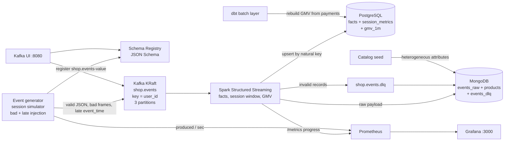

# shop-stream

本機的電商 event pipeline。一條指令拉起 Kafka（KRaft）、Schema Registry、一支 Python producer、Spark Structured Streaming、PostgreSQL 和 MongoDB。Event 會 upsert 進有型別的 table，也會寫進一份 raw document collection。

Milestone 1 是 ingest path。Milestone 2 加上正確性：event-time watermark、依 natural key 的 idempotent upsert、session window、1 分鐘 tumbling GMV、dead-letter。Milestone 3 加上 Prometheus、Grafana，以及在 Postgres 上的 dbt batch layer，用來對帳 streaming GMV。BigQuery 和 load test 還在後面。可以在筆電上跑，也可以順著講。

## Architecture



Generator 仍會編 `session_id`，那只是 producer 圖方便。Session window 不讀它，而是用 `user_id` 加 `event_time` 的 gap 算出來。

## 各元件在做什麼

| 元件 | 角色 |
| --- | --- |
| Event generator | 走一個很小的 per-user state machine：page view、add to cart、order、payment。把 device 和 UTM 黏在同一個 session 上。先註冊 JSON Schema，再以 key `user_id` produce 到 `shop.events`。速率是 `EVENTS_PER_SECOND`。另外依 `BAD_EVENT_RATE` 塞不合法的 bytes，依 `LATE_EVENT_RATE` 把 `event_time` 往回撥。 |
| Kafka | 一台 combined KRaft broker。沒有 ZooKeeper。`kafka/create-topics.sh` 建立 `shop.events` 和 `shop.events.dlq`（各 3 partitions、RF 1、retention 24 小時）。Auto-create 關掉，避免打錯字多生出一個 1-partition topic。 |
| Schema Registry | 把契約放在 subject `shop.events-value`（TopicNameStrategy）。Registry 沒起來，producer 就拒絕啟動，對不上 schema 的 payload 不會進 topic。 |
| Spark | 三條 query，各有自己的 checkpoint。Facts 做 upsert 和 DLQ。Session window 用 append mode（watermark 越過 session end 才寫出）。GMV tumbling window 用 update mode。Driver 上的 `StreamingQueryListener` 把 throughput、batch duration、watermark drop、state rows 打到 `:9095/metrics`。 |
| PostgreSQL | 有型別的 fact table（events、orders、order items、payments），加上 `session_metrics` 和 `gmv_1m`。初始化 SQL 在 `postgres/init/`。 |
| MongoDB | `events_raw` 留著巢狀 payload，以 `event_id` unique upsert。`events_dlq` 以 source offset unique upsert。`products` 是一份 catalog，`attributes` 物件的形狀依 category 而變。 |
| Kafka UI | 在 `http://localhost:8080` 瀏覽 topic 和已註冊的 schema。不在資料路徑上。 |
| Spark UI | Query 在跑的時候開 `http://localhost:4040`。 |
| Prometheus / Grafana | Prometheus 刮 Spark、generator、lag exporter、kafka-exporter、postgres-exporter。Grafana 開機就載入 dashboard，不用手動 import。帳號 `admin` / `admin`，匿名也可以看。 |
| dbt | `make dbt` 在 Postgres 上跑 staging → intermediate → marts，並對 `gmv_1m` 和從 `payments` 重算的 GMV 做 reconciliation。 |

## 怎麼跑

需要 Docker Desktop（或 Engine）加上 Compose v2。整組 stack 大約吃 4 GB 記憶體。

```bash
make up      # copies .env.example if needed, builds, starts detached
make check   # data, prometheus targets, dbt, then the Spark kill test
make logs    # follow everything
make down    # stop, keep volumes
make reset   # stop and delete volumes
```

`docker compose up --build` 做同樣的啟動，只是跑在前景。預設值寫在 `docker-compose.yml`，沒有 `.env` 也沒關係。要改速率、port 或本機資料庫密碼，編輯 `.env`（對照 `.env.example`）。這組密碼只給筆電本機用。

`make check` 會等到 facts、`session_metrics`、`gmv_1m`、late events 和 Mongo `events_dlq` 都有資料，確認 Prometheus target 都是 up、dbt test 通過，再停掉 generator、對 Spark 送 `SIGKILL`，確認那些 count 沒有變。第一次啟動請多等幾分鐘：Spark 要先起來，然後一個 5 秒的 trigger 才會把 batch 寫下去。Check 結束會把 generator 拉回來。

常用的旋鈕：

| 變數 | 預設 | 作用 |
| --- | --- | --- |
| `EVENTS_PER_SECOND` | `5` | Producer 速率。`0.5` 是慢一點的筆電。 |
| `TOPIC_PARTITIONS` | `3` | 只在 topic 建立時生效。改完要 `make reset`。 |
| `TRIGGER_INTERVAL` | `5 seconds` | Spark micro-batch trigger。 |
| `SIM_SEED` | 空 | 設一個整數，就可以重放同一段 session 序列。 |
| `BAD_EVENT_RATE` | `0.02` | 不走 serializer 的壞 record 比例。`0` 就關掉。 |
| `LATE_EVENT_RATE` | `0.05` | 合法、但 `event_time` 被往回撥的比例。 |
| `LATE_EVENT_LAG_SECONDS` | `180` | 往回撥幾秒。要大於 watermark，才算 too-late。 |
| `WATERMARK_DELAY` | `1 minute` | Session 和 GMV query 的允許遲到。 |
| `GMV_WINDOW` | `1 minute` | GMV tumbling window。 |
| `SESSION_GAP` | `30 seconds` | 同一個 user 多久沒有 event 就結束一個 session。 |

Host 上的 port：Kafka `9092`、Schema Registry `8081`、Postgres `5432`、Mongo `27017`、Kafka UI `8080`、Spark UI `4040`。

`make down && make up` 會接著跑。Kafka log、Postgres、Mongo、Spark checkpoint 和 Prometheus 都是 named volume，所以 offset 和 row 在重啟之後還在。`make reset` 是 `docker compose down -v`，會刪掉這個 compose file 裡的每一個 named volume，包含 Kafka、Postgres、Mongo、Spark checkpoint、Prometheus。`make down` 只停容器，資料還在。不要只刪 Kafka 或只刪 checkpoint：checkpoint 會指到新 broker 上不存在的 offset（`failOnDataLoss` 是 false，所以 query 會繼續，但你已經跳過一段資料）。

看 dashboard：

```bash
make dashboards
```

Grafana 是 `http://localhost:3000`，帳號 `admin` / `admin`。匿名 Viewer 也開著，所以 `make up` 之後不用點 import。Prometheus 的 alert 在 `http://localhost:9090/alerts`。沒有 Alertmanager。

跑 batch layer：

```bash
make dbt
```

改完 `catalog/products.json` 之後重新灌 products：

```bash
make seed
```

Wire format 和 session simulator 的 unit test，不用 Docker：

```bash
make test
```

Simulator test 裡的 JSON Schema 檢查，要裝了 `jsonschema` 才會跑。Generator image 一律會裝。

## 看資料

```bash
docker compose exec postgres psql -U shop -d shop
```

```sql
SELECT event_type, count(*)
FROM events
GROUP BY event_type
ORDER BY event_type;

-- Funnel for one user, in producer order. Partition order is the reason
-- the Kafka key is user_id; this query still sorts because the landing
-- table is append-only across partitions.
SELECT event_time, event_type, session_id, page_url, product_sku, order_id
FROM events
WHERE user_id = (SELECT user_id FROM orders ORDER BY id DESC LIMIT 1)
ORDER BY event_time;
```

```bash
docker compose exec mongo mongosh shop
```

```javascript
db.products.find({ category: "electronics" }, { name: 1, attributes: 1 })
db.products.find({ category: "apparel" }, { name: 1, attributes: 1 })
db.events_raw.find({ event_type: "order_created" }).limit(1)
```

Electronics 的 document 帶 warranty 和 dimensions。Apparel 帶 sizes 和 material。同一個 collection，沒有共用的 attribute schema。這就是 Mongo 那個例子。

## 目錄

```
docker-compose.yml          stack、記憶體上限、healthcheck
.env.example                每一個旋鈕，沒有真正的 secret
Makefile                    up、down、logs、check、reset、seed、test
kafka/create-topics.sh      shop.events 的 partition 數和 retention
postgres/init/01_tables.sql landing table
catalog/products.json       catalog 的唯一來源
generator/                  producer、simulator、schema、catalog seed
spark/job/                  facts、watermarked session / GMV、upsert、DLQ
scripts/check.sh            make check 用的驗證
tests/                      simulator 的不變量，以及 wire-format decoder
```

## Design decisions

### Topic、partitions、key

一個 topic，`shop.events`。三個 partition，replication factor 1。Record key 是 `user_id`。

Kafka 只保證同一個 partition 裡的順序，預設 partitioner 會對 key 做 hash。用 `user_id` 當 key，同一個 user 的每個 event 都會落在同一個 partition，順序就是 producer 送出的順序。一條 funnel（view，然後 cart，然後 order，然後 payment）不用下游再排序就保持這個順序。

`order_id` 不能當 key。`page_view` 和 `add_to_cart` 發生在 order 存在之前，那些 record 會被 hash 到別的地方（null key 則是 round-robin）。`session_id` 也能讓一次造訪維持順序，但那是 producer 編的。Session window 從 `event_time` 算，不信任這個 id。跨 session 仍然穩定的實體是 user，所以 key 還是 `user_id`。

三個 partition 是本機的折衷。一個 partition 會把這個決定藏起來，因為反正全部都有序。一台 broker 上 partition 再多，只是多一些檔案。Replication factor 是 1，因為只有一台 broker。`acks=all` 配 `min.insync.replicas=1`，是這台 broker 實際上給得了的最強保證。

一種 event type 一個 topic 被否決了。把 `page_view` 和 `order_created` 拆開，就失去 per-user 的順序，還得用時間做 join 才能把 funnel 拼回來。一條 stream 留著因果順序。代價是契約比較寬：跟 event 種類有關的欄位放在 `payload` 底下，只要 payment 的 consumer 對 `event_type` 做 filter。Record header 也放了 `event_type`，後面的 consumer 可以不用 deserialize body 就分流。

Producer 另外設了 `enable.idempotence=true`。重試的 produce 不會把同一筆 record 再 append 一次。這只是 producer idempotence。

### Postgres 放 projections，Mongo 放 documents

Postgres 放 dashboard 或 dbt project 會掃描的 row：

- `events` 是每個 event 一列攤平的 row：誰、何時、device、UTM、page，以及把它連到 order 或 payment 的 id。
- `orders`、`order_items`、`payments` 是帶金額和 line item 的 projection。GMV 應該落在 `payments`，而不是對那張很寬的 event table 做加總。

欄位有型別（`TIMESTAMPTZ`、`NUMERIC(12,2)`）、有 check（`event_type` enum、`qty > 0`），並依 user + time 建 index。金額寫成兩位小數的 numeric，不是 float column。

Fact table 的 primary key 仍是 surrogate `id`。`event_id`、`order_id`、`(order_id, sku)`、`payment_id` 另外是 UNIQUE，sink 對它們做 upsert。Aggregate table 沒有 surrogate：`session_metrics` 的 primary key 是 `(user_id, session_start)`，`gmv_1m` 是 `(window_start, currency)`。下面的 delivery 一節說明為什麼這還不叫 exactly-once。

Mongo 放兩種跟固定 table 打架的形狀：

1. Raw event。巢狀的 `payload`、Kafka partition 和 offset、schema id。以 `event_id` unique upsert。Projection 寫錯的時候，這份 document 就是拿來回放的來源。契約裡的東西沒有被丟掉。不合法的 record 不進這裡，它們進 `events_dlq`。
2. Product catalog。Electronics 有電池續航和一個 dimension 物件。Apparel 有 size 陣列和 material。Grocery 有 origin 和保存期限。Beauty 有 shade 和 SPF。一組 nullable column 大部分會是空的。Entity-attribute-value table 又會把 document 藏起來。`attributes` 就維持一個物件。

Event 的 line item 只存 sku、name、category、qty 和 unit price。它不複製 `attributes`。Catalog 是那份非結構化的紀錄；order line 是當時實際計價的快照。

Mongo URI 設了 `retryWrites=false`。Retryable write 需要 replica set，而這裡是單一 `mongod`，筆電不必為了它跑三個 node。

### Schema Registry，以及為什麼用 JSON Schema

Subject `shop.events-value`，TopicNameStrategy，registry 的預設 compatibility（BACKWARD）。Schema 檔是 `generator/schema/ecommerce_event.json`。Generator 在啟動時註冊它，serializer 用 `auto.register.schemas=false` 和 `use.latest.version=true`，所以訊息裡的 id 就是剛剛註冊的那個 id。Validation 是開的：對不上 schema 的 document 不會被 produce。

Topic 上的 bytes 是 Confluent prefix，不是裸的 JSON：

```
byte 0      magic 0x00
bytes 1-4   schema id, big-endian
bytes 5-    UTF-8 JSON
```

`spark/job/wire.py` 就是這個 parser。Spark 接著套上一份對應 schema 的 `StructType`（`spark/job/schema.py`）。M1 的 reader 不會去問 registry。Schema id 存在 Postgres row 和 Mongo document 上，後面的版本才能用 id 去取 writer schema。Magic byte `0x01`（schema GUID）會被拒絕。

這個 milestone 用 JSON Schema 而不是 Avro：Kafka UI 裡可以直接讀 record，prefix 拿掉之後 `from_json` 就是一般的 PySpark。代價是訊息大小。大小開始有差的時候，再換成 Avro 或 Protobuf。Registry、subject 和那 5-byte prefix 都不用改。

### Delivery semantics：at-least-once 加上 idempotent sink

Producer 是 idempotent 的，而且用 `acks=all`，所以 producer 自己的重試不會把同一筆 record append 兩次。

Spark Structured Streaming 在 `foreachBatch` 返回之後才 commit checkpoint。Offset 住在 checkpoint volume，不在 Kafka consumer group。Consumer-group lag 描述不了這個 job。M3 應該用 streaming query 的 source metrics，或是刻意去 commit 一個 group id。

Process 如果在 sink commit 之後、checkpoint 寫入之前死掉，micro-batch 會再跑一次。這是 at-least-once。Exactly-once 要的是 offset 和 sink 寫入在同一個 transaction 裡。這裡有 Postgres 和 Mongo 兩個 sink，再加上 Kafka offset，沒有一個 transaction 罩得住三邊，所以不宣稱 exactly-once。

實務上用的是 at-least-once 加 idempotent write。重跑的 batch 打到同一個 natural key，`ON CONFLICT DO UPDATE` 蓋過同一列，row count 不變。效果對那些 key 來說是 effectively-once：GMV 不會因為 Spark 重啟被加兩次。`make check` 會停掉 generator、對 Spark 送 `SIGKILL`，再比對 events、orders、order items、payments、session、GMV 和 Mongo 的 count。

Kafka DLQ 是這個規則的例外。Topic 是 append-only，replay 可能再寫一筆 poison message。Mongo `events_dlq` 用 source topic、partition、offset 當 unique key upsert，所以查得到的那份不會重複。Compacted topic 不適合當錯誤紀錄，compaction 會把 payload 清掉。

### Watermark 與 too-late

預設 watermark 是 **1 minute**，GMV 是 **1 minute** tumbling window，session gap 是 **30 seconds**。三個都是 Spark interval，可以用環境變數改。

Generator 的 `event_time` 是 wall-clock UTC。1 分鐘蓋得住筆電上一次 micro-batch 的延遲，又不會把 1 分鐘的 GMV window 開一整天。再短，一次慢 batch 或暫停就會把合法的 payment 從 aggregate 拿掉。再長，state 留更久，demo 也要等更久才看得到 window 被清掉。

Too-late 的定義是：event time 早於這條 query 已經看過的 max event time 減掉 watermark。Session 和 GMV 兩條 query 會丟掉這些 record，也不會重開已經被 watermark 越過的 window。Fact table 不套這個 watermark。晚到的 payment 仍然 upsert 進 `payments` 和 `events`，只是不能再改已經走掉的 GMV window。這是刻意的拆法：事實表要完整，aggregate 要有界。

Spark 的 watermark 是看到資料之後才建立的。頭幾個 micro-batch 還沒有 watermark，所以少數一開始就很舊的 event 仍可能進 window。Watermark 建立之後，規則才生效。`LATE_EVENT_LAG_SECONDS` 預設 180，大於 1 分鐘，用來製造 too-late。`make check` 會確認 `events` 裡看得到這些晚到的 row，同時 `gmv_1m` 也有 window。

Session gap 用 30 秒。預設速率下，同一個 user 在活躍時大約每幾秒被碰到一次，所以 30 秒的安靜代表這次造訪結束。再短會把同一次逛店切開。再長的話，append mode 要等更久才吐出列（還要再加 watermark）。這條 window 不讀 `session_id`。Fact row 上仍留著 producer 的 `session_id`，面試時可以拿來對照：producer 編的 id 和 engine 算的 window 回答的是不同問題。

Spark 的 session window 不支援 update mode，所以這條 query 用 append：watermark 越過 session end 才寫出一列。以 30 秒 gap 加 1 分鐘 watermark，大約是最後一個 event 之後 90 秒。GMV 的 tumbling window 支援 update mode，進行中的那一分鐘每個 trigger 都會重寫，sink 再 upsert。Watermark 兩邊都負責丟掉 too-late，也負責把過期的 state 清掉。

### Dead-letter

不進 fact table 的只有三種：`invalid_frame`（沒有 Confluent magic byte 或 prefix 被截斷）、`unparseable`（prefix 後面不是 JSON）、`schema_violation`（JSON 在，但對不上契約，例如 `event_type` 不在 enum 裡）。Late data 不是其中一種。

`BAD_EVENT_RATE` 讓 generator 繞過 serializer，直接送這三種 bytes。Serializer 自己會擋掉不合法的 document，如果壞資料也走它，DLQ 永遠是空的。

DLQ topic 是 `shop.events.dlq`。Value 是我們組的 JSON，帶 `error_reason` 和 `error_class`，不註冊進 Schema Registry。Poison payload 不該再被契約擋一次。Key 沿用原本的 message key；注入的壞 record 用 key `bad`，因為它們沒有 `user_id`。Topic 不 compact。

### 為什麼用 foreachBatch

Kafka 的讀取、JSON parse 和 window aggregation 留在 streaming plan 裡，Spark UI 上應該看得到。寫出是一個看得到整份 micro-batch 的 function，upsert 和 DLQ 分流都在這裡。一秒幾個 event 的時候，在 driver 上 `collect` 整份 batch 沒問題，`maxOffsetsPerTrigger`（500）也把它卡住。這不是 production 量級該有的形狀。接點本身不變：load test 說要換的時候，把 `collect` 換成每個 partition 一次 JDBC write。

### 筆電的資源上限

`docker-compose.yml` 裡的大致上限：Kafka heap 384 MB（container 1 GB）、Schema Registry heap 320 MB（container 768 MB）、Spark driver 1 GB（container 2 GB）、Mongo WiredTiger cache 0.25 GB、Kafka UI heap 256 MB。Postgres shared buffers 是 64 MB。整組 stack 大約落在 4 GB。Kafka 的 data retention 是 24 小時。Container log 以 10 MB × 3 輪替。

Spark 在一個 container 裡跑 `local[2]`。沒有 cluster，也沒有 Kubernetes。

## Observability

Structured Streaming 預設不 commit consumer group，所以 `kafka-exporter` 看不到 Spark 的 lag。它仍然在 stack 裡，用來說明「group lag 這條路對這個 job 是空的」。真正的 lag 是 `lag-exporter`：它讀 checkpoint 裡已 commit 的 resume offset，減去 Kafka end offset。Driver 停掉以後 checkpoint 凍結、generator 繼續寫，這個 gauge 還在被 Prometheus 刮，所以可以把 Spark `stop` 掉來觸發 `ShopSparkLagHigh`（總 lag > 100，持續 2 分鐘）。`ShopDlqRateHigh` 是 DLQ 超過 1 event/s 持續 2 分鐘；預設 `BAD_EVENT_RATE=0.02` 大約 0.1 event/s，規則會載入但不會響。

Dashboard `shop-stream` 的面板：

| 面板 | 在看什麼 |
| --- | --- |
| Throughput in vs processed | 每條 query 的 `inputRowsPerSecond` 和 `processedRowsPerSecond`。in 長期高於 processed，代表跟不上。 |
| Generator produced / sec | `on_time`、`late`、`bad` 三種產出。late 是合法但 `event_time` 被往回撥的；bad 會進 DLQ。 |
| Spark checkpoint lag | 每條 query 落後 Kafka end offset 的筆數。Spark 停著的時候這條線會爬升。 |
| Batch duration | 上一個 micro-batch 的 `triggerExecution` 毫秒數。 |
| Rows dropped by watermark | session / GMV state 丟掉的 late row。Fact table 仍保留那些 payment。 |
| State rows | window state 裡還留著幾列。 |
| DLQ by category | `invalid_frame`、`unparseable`、`schema_violation` 的速率。 |

要在 Grafana 看 late data：看「Rows dropped by watermark」。session 和 GMV query 會增加；`shop-facts` 通常是 0，因為 fact sink 沒有 watermark。同一段時間 generator 的 `late` 系列仍在增加，Postgres 的 `payments` 也還有那些列。這就是 speed layer 少算、batch layer 補得回來的那一段。

## dbt：batch layer 和 reconciliation

`make dbt` 跑 `dbt build`、`dbt source freshness`、`dbt docs generate`。分層是 staging（view）→ intermediate（view）→ marts（table），schema 分別是 `staging`、`intermediate`、`marts`。

- `fct_gmv_1m` 用 `payments.event_time` 重切 1 分鐘，**包含** late payment。
- `fct_gmv_daily` 是上面的日彙總。
- `fct_orders` 是 orders fact。
- `fct_funnel_daily` 是一天裡四種 event 的筆數。
- `recon_gmv_1m` 把 batch GMV 和 streaming `gmv_1m` 放在同一分鐘，`gmv_diff = batch - streaming`，`late_gmv` 是 `event_time` 比 `ingested_at` 早超過 2 分鐘的金額。

Custom test 要求 `0 <= gmv_diff <= late_gmv`（容許 0.01）。Streaming 少算的部分必須被 late payment 解釋；streaming 比 batch 多，測試會失敗。頭幾個 micro-batch 還沒有 watermark，所以有些 late payment 仍會進 `gmv_1m`，diff 會小於 `late_gmv`，測試允許這個情況。

這是 lambda 的 speed layer 對 batch layer：streaming GMV 為了有界的 state 和確定的 window 會少算；batch 從 `payments` 重算，把 watermark 丟掉的錢補回來。面試時可以講：不要用 consumer-group lag 描述一個不 commit group 的 Structured Streaming job；reconciliation 的 diff 要能指回 late data，而不是只剩一個對不上的數字。

## 還沒做的事

Load test、BigQuery。沒有 Kubernetes，也沒有 Alertmanager。
