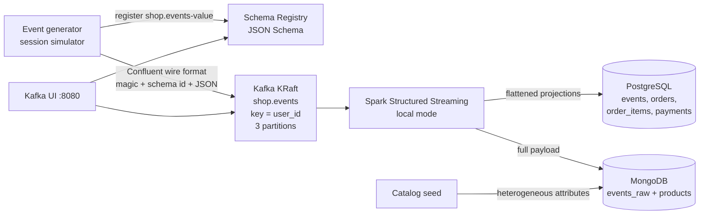

# shop-stream

本機的電商 event pipeline。一條指令拉起 Kafka（KRaft）、Schema Registry、一支 Python producer、Spark Structured Streaming、PostgreSQL 和 MongoDB。Event 會寫進有型別的 table，也會寫進一份 raw document collection。

這是 Milestone 1：一條可以直接在筆電上跑、面試時順著講的 ingest path。Watermark、idempotent upsert、session window、dead-letter topic、metrics 和 dbt 都是後面的 milestone。程式裡已經標了它們要接上去的位置。

## Architecture



Generator 自己編 `session_id`。Pipeline 目前沒有任何一段在計算 session。這個區別就是重點：這個 id 只是 producer 圖方便，真正的 session window（M2）必須從 `event_time` 推回來。

## 各元件在做什麼

| 元件 | 角色 |
| --- | --- |
| Event generator | 走一個很小的 per-user state machine：page view、add to cart、order、payment。把 device 和 UTM 黏在同一個 session 上。先註冊 JSON Schema，再以 key `user_id` produce 到 `shop.events`。速率是 `EVENTS_PER_SECOND`。 |
| Kafka | 一台 combined KRaft broker。沒有 ZooKeeper。Topic 由 `kafka/create-topics.sh` 建立（3 partitions、RF 1、retention 24 小時）。Auto-create 關掉，避免打錯字多生出一個 1-partition topic。 |
| Schema Registry | 把契約放在 subject `shop.events-value`（TopicNameStrategy）。Registry 沒起來，producer 就拒絕啟動，對不上 schema 的 payload 不會進 topic。 |
| Spark | 從 `earliest` 讀 topic（第一次跑完之後以 checkpoint 為準），剝掉 5-byte 的 Confluent prefix，用一份明確的 struct 解析 JSON，每個 micro-batch 在 `foreachBatch` 裡寫出。Checkpoint 放在 volume。 |
| PostgreSQL | 有型別的 landing table。每個 event 一列攤平的 row，另外有 orders、order items、payments。初始化 SQL 在 `postgres/init/`。 |
| MongoDB | `events_raw` 留著巢狀 payload，加上 Kafka offset 和 schema id。`products` 是一份 catalog，`attributes` 物件的形狀依 category 而變。 |
| Kafka UI | 在 `http://localhost:8080` 瀏覽 topic 和已註冊的 schema。不在資料路徑上。 |
| Spark UI | Query 在跑的時候開 `http://localhost:4040`。 |

## 怎麼跑

需要 Docker Desktop（或 Engine）加上 Compose v2。整組 stack 大約吃 4 GB 記憶體。

```bash
make up      # copies .env.example if needed, builds, starts detached
make check   # waits until both sinks have rows, then prints counts
make logs    # follow everything
make down    # stop, keep volumes
make reset   # stop and delete volumes
```

`docker compose up --build` 做同樣的啟動，只是跑在前景。預設值寫在 `docker-compose.yml`，沒有 `.env` 也沒關係。要改速率、port 或本機資料庫密碼，編輯 `.env`（對照 `.env.example`）。這組密碼只給筆電本機用。

`make check` 只有在 Postgres 已經有 events、orders、payments，而且 Mongo 已經有 raw events 和 products 時才會 exit 0。第一次啟動請多等幾分鐘：Spark 要先起來，然後一個 5 秒的 trigger 才會把 batch 寫下去。

常用的旋鈕：

| 變數 | 預設 | 作用 |
| --- | --- | --- |
| `EVENTS_PER_SECOND` | `5` | Producer 速率。`0.5` 是慢一點的筆電。 |
| `TOPIC_PARTITIONS` | `3` | 只在 topic 建立時生效。改完要 `make reset`。 |
| `TRIGGER_INTERVAL` | `5 seconds` | Spark micro-batch trigger。 |
| `SIM_SEED` | 空 | 設一個整數，就可以重放同一段 session 序列。 |

Host 上的 port：Kafka `9092`、Schema Registry `8081`、Postgres `5432`、Mongo `27017`、Kafka UI `8080`、Spark UI `4040`。

`make down && make up` 會接著跑。Kafka log、Postgres、Mongo 和 Spark checkpoint 都是 volume，所以 offset 和 row 在重啟之後還在。`make reset` 會把這四份一起清掉。不要只刪 Kafka 或只刪 checkpoint：checkpoint 會指到新 broker 上不存在的 offset（`failOnDataLoss` 是 false，所以 query 會繼續，但你已經跳過一段資料）。

改完 `catalog/products.json` 之後重新灌 products：

```bash
make seed
```

Wire format 和 session simulator 的 unit test，不用 Docker：

```bash
make test
```

Simulator test 裡的 JSON Schema 檢查，要裝了 `jsonschema` 才會跑。Generator image 一律會裝。

## 看資料

```bash
docker compose exec postgres psql -U shop -d shop
```

```sql
SELECT event_type, count(*)
FROM events
GROUP BY event_type
ORDER BY event_type;

-- Funnel for one user, in producer order. Partition order is the reason
-- the Kafka key is user_id; this query still sorts because the landing
-- table is append-only across partitions.
SELECT event_time, event_type, session_id, page_url, product_sku, order_id
FROM events
WHERE user_id = (SELECT user_id FROM orders ORDER BY id DESC LIMIT 1)
ORDER BY event_time;
```

```bash
docker compose exec mongo mongosh shop
```

```javascript
db.products.find({ category: "electronics" }, { name: 1, attributes: 1 })
db.products.find({ category: "apparel" }, { name: 1, attributes: 1 })
db.events_raw.find({ event_type: "order_created" }).limit(1)
```

Electronics 的 document 帶 warranty 和 dimensions。Apparel 帶 sizes 和 material。同一個 collection，沒有共用的 attribute schema。這就是 Mongo 那個例子。

## 目錄

```
docker-compose.yml          stack、記憶體上限、healthcheck
.env.example                每一個旋鈕，沒有真正的 secret
Makefile                    up、down、logs、check、reset、seed、test
kafka/create-topics.sh      shop.events 的 partition 數和 retention
postgres/init/01_tables.sql landing table
catalog/products.json       catalog 的唯一來源
generator/                  producer、simulator、schema、catalog seed
spark/job/                  streaming query、parse、sink
scripts/check.sh            make check 用的驗證
tests/                      simulator 的不變量，以及 wire-format decoder
```

## Design decisions

### Topic、partitions、key

一個 topic，`shop.events`。三個 partition，replication factor 1。Record key 是 `user_id`。

Kafka 只保證同一個 partition 裡的順序，預設 partitioner 會對 key 做 hash。用 `user_id` 當 key，同一個 user 的每個 event 都會落在同一個 partition，順序就是 producer 送出的順序。一條 funnel（view，然後 cart，然後 order，然後 payment）不用下游再排序就保持這個順序。

`order_id` 不能當 key。`page_view` 和 `add_to_cart` 發生在 order 存在之前，那些 record 會被 hash 到別的地方（null key 則是 round-robin）。`session_id` 也能讓一次造訪維持順序，但整個系統裡只有 generator 知道它。M2 要從 `event_time` 推出 session，而跨 session 仍然穩定的實體是 user。

三個 partition 是本機的折衷。一個 partition 會把這個決定藏起來，因為反正全部都有序。一台 broker 上 partition 再多，只是多一些檔案。Replication factor 是 1，因為只有一台 broker。`acks=all` 配 `min.insync.replicas=1`，是這台 broker 實際上給得了的最強保證。

一種 event type 一個 topic 被否決了。把 `page_view` 和 `order_created` 拆開，就失去 per-user 的順序，還得用時間做 join 才能把 funnel 拼回來。一條 stream 留著因果順序。代價是契約比較寬：跟 event 種類有關的欄位放在 `payload` 底下，只要 payment 的 consumer 對 `event_type` 做 filter。Record header 也放了 `event_type`，後面的 consumer 可以不用 deserialize body 就分流。

Producer 另外設了 `enable.idempotence=true`。重試的 produce 不會把同一筆 record 再 append 一次。這只是 producer idempotence。

### Postgres 放 projections，Mongo 放 documents

Postgres 放 dashboard 或 dbt project 會掃描的 row：

- `events` 是每個 event 一列攤平的 row：誰、何時、device、UTM、page，以及把它連到 order 或 payment 的 id。
- `orders`、`order_items`、`payments` 是帶金額和 line item 的 projection。GMV 應該落在 `payments`，而不是對那張很寬的 event table 做加總。

欄位有型別（`TIMESTAMPTZ`、`NUMERIC(12,2)`）、有 check（`event_type` enum、`qty > 0`），並依 user + time 建 index。金額寫成兩位小數的 numeric，不是 float column。

這些是 landing table。Primary key 是 surrogate `id`。`event_id` 有 index，但不是 unique。這是刻意的，也就是下面 M1 的 delivery 故事。

Mongo 放兩種跟固定 table 打架的形狀：

1. Raw event。巢狀的 `payload`、Kafka partition 和 offset、schema id。Projection 寫錯的時候，這份 document 就是拿來回放的來源。契約裡的東西沒有被丟掉。
2. Product catalog。Electronics 有電池續航和一個 dimension 物件。Apparel 有 size 陣列和 material。Grocery 有 origin 和保存期限。Beauty 有 shade 和 SPF。一組 nullable column 大部分會是空的。Entity-attribute-value table 又會把 document 藏起來。`attributes` 就維持一個物件。

Event 的 line item 只存 sku、name、category、qty 和 unit price。它不複製 `attributes`。Catalog 是那份非結構化的紀錄；order line 是當時實際計價的快照。

Mongo URI 設了 `retryWrites=false`。Retryable write 需要 replica set，而這裡是單一 `mongod`，筆電不必為了它跑三個 node。

### Schema Registry，以及為什麼用 JSON Schema

Subject `shop.events-value`，TopicNameStrategy，registry 的預設 compatibility（BACKWARD）。Schema 檔是 `generator/schema/ecommerce_event.json`。Generator 在啟動時註冊它，serializer 用 `auto.register.schemas=false` 和 `use.latest.version=true`，所以訊息裡的 id 就是剛剛註冊的那個 id。Validation 是開的：對不上 schema 的 document 不會被 produce。

Topic 上的 bytes 是 Confluent prefix，不是裸的 JSON：

```
byte 0      magic 0x00
bytes 1-4   schema id, big-endian
bytes 5-    UTF-8 JSON
```

`spark/job/wire.py` 就是這個 parser。Spark 接著套上一份對應 schema 的 `StructType`（`spark/job/schema.py`）。M1 的 reader 不會去問 registry。Schema id 存在 Postgres row 和 Mongo document 上，後面的版本才能用 id 去取 writer schema。Magic byte `0x01`（schema GUID）會被拒絕。

這個 milestone 用 JSON Schema 而不是 Avro：Kafka UI 裡可以直接讀 record，prefix 拿掉之後 `from_json` 就是一般的 PySpark。代價是訊息大小。大小開始有差的時候，再換成 Avro 或 Protobuf。Registry、subject 和那 5-byte prefix 都不用改。

### Delivery semantics，以及 M2 會改什麼

從頭到尾是 at-least-once。

- Producer 是 idempotent 的，而且用 `acks=all`，所以 producer 自己的重試不會重複。
- Spark Structured Streaming 在 `foreachBatch` 返回之後才 commit checkpoint。Offset 住在 checkpoint volume，不在 Kafka consumer group。Consumer-group lag 描述不了這個 job。M3 應該用 streaming query 的 source metrics，或是刻意去 commit 一個 group id。
- Process 如果在 Postgres commit 之後、checkpoint 寫入之前死掉，micro-batch 會再跑一次，landing table 就會多一份那些 row。如果死在 commit 之前，batch 只是重試。

解析不了的 record（錯誤的 magic byte、壞掉的 UTF-8、對不上 struct 的 JSON）會被計數、寫 log，然後丟掉。它們不會送去 dead-letter topic。從 batch 返回，就會把 offset commit 過這些 record。

沒有 watermark。`event_time` 有存下來，但沒有用來關閉 window，也沒有用來判斷一筆 event 是不是 late。

M2 改的是 consumer 這一側，位置已經標在 `spark/job/parse.py` 和 `spark/job/sinks.py`：

- 在 `event_time` 上加 watermark 和 late-data policy
- 以 `event_id` 做 idempotent write：unique constraint 加上 upsert，重放的 batch 就不會把 GMV 算兩次
- session window，從 event time 算出來，而不是信任 `session_id`
- 在 `payments` 上做即時的 GMV query
- 解析失敗的 record 進 dead-letter topic，再落地到 Mongo

這些還沒接上之前，不要把 row count 當成 exactly-once 的總數。`make reset` 再跑一次，才是乾淨的量測。

### 為什麼用 foreachBatch

Kafka 的讀取和 JSON 的解析留在 streaming plan 裡，Spark UI 上應該看得到這一段。寫出是一個看得到整份 micro-batch 的 function。Upsert、dead-letter 的拆分，以及「Postgres 然後 Mongo，否則兩邊都不算」的決定，都該放在這個 function。一秒幾個 event 的時候，在 driver 上 `collect` 整份 batch 沒問題，`maxOffsetsPerTrigger`（500）也把它卡住。這不是 production 量級該有的形狀。接點本身不變：load test 說要換的時候，把 `collect` 換成每個 partition 一次 JDBC write。

### 筆電的資源上限

`docker-compose.yml` 裡的大致上限：Kafka heap 384 MB（container 1 GB）、Schema Registry heap 320 MB（container 768 MB）、Spark driver 768 MB（container 2 GB）、Mongo WiredTiger cache 0.25 GB、Kafka UI heap 256 MB。Postgres shared buffers 是 64 MB。整組 stack 大約落在 4 GB。Kafka 的 data retention 是 24 小時。Container log 以 10 MB × 3 輪替。

Spark 在一個 container 裡跑 `local[2]`。沒有 cluster，也沒有 Kubernetes。

## 這個 milestone 不做的事

Watermark、late data、`dropDuplicates`、unique `event_id`、session window、把 GMV 做成 streaming aggregation、dead-letter topic、Prometheus、Grafana、dbt、load test、BigQuery。Landing table 的註解，以及 `parse.py` 和 `sinks.py` 裡的註記，寫的就是哪一個 function 要改。
