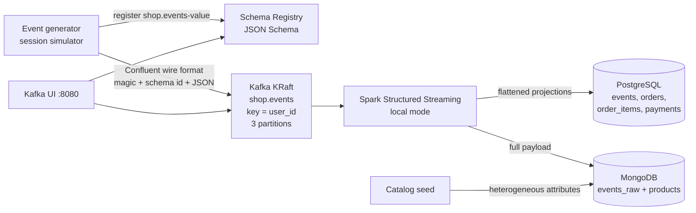

# shop-stream

A local e-commerce event pipeline. One command brings up Kafka (KRaft), Schema Registry, a Python producer, Spark Structured Streaming, PostgreSQL, and MongoDB. Events flow into typed tables and into a raw document collection.

This is Milestone 1: a straight ingest path you can run on a laptop and walk through in an interview. Watermarks, idempotent upserts, session windows, a dead-letter topic, metrics, and dbt are later milestones. The code marks where they plug in.

## Architecture



The generator invents `session_id`. Nothing in the pipeline computes a session yet. That distinction is the point: the id is a producer convenience, and a real session window (M2) has to be derived from `event_time`.

## What each piece does

| Piece | Role |
| --- | --- |
| Event generator | Walks a small per-user state machine: page view, add to cart, order, payment. Sticks a device and a UTM onto the session. Registers the JSON Schema, then produces to `shop.events` with key `user_id`. Rate is `EVENTS_PER_SECOND`. |
| Kafka | One combined KRaft broker. No ZooKeeper. The topic is created by `kafka/create-topics.sh` (3 partitions, RF 1, 24h retention). Auto-create is off so a typo cannot spawn a 1-partition topic. |
| Schema Registry | Stores the contract under subject `shop.events-value` (TopicNameStrategy). The producer refuses to start if the registry is down, so a payload that fails the schema never reaches the topic. |
| Spark | Reads the topic from `earliest` (checkpoint wins after the first run), strips the 5-byte Confluent prefix, parses JSON with an explicit struct, and writes each micro-batch in `foreachBatch`. Checkpoint is a volume. |
| PostgreSQL | Typed landing tables. One flattened row per event, plus orders, order items, and payments. Init SQL is in `postgres/init/`. |
| MongoDB | `events_raw` keeps the nested payload plus Kafka offset and schema id. `products` is a catalog whose `attributes` object changes shape by category. |
| Kafka UI | Browse the topic and the registered schema at `http://localhost:8080`. Not on the data path. |
| Spark UI | `http://localhost:4040` while the query is running. |

## Run it

Docker Desktop (or Engine) with Compose v2, and about 4 GB of memory for the stack.

```bash
make up      # copies .env.example if needed, builds, starts detached
make check   # waits until both sinks have rows, then prints counts
make logs    # follow everything
make down    # stop, keep volumes
make reset   # stop and delete volumes
```

`docker compose up --build` does the same start in the foreground. Defaults live in `docker-compose.yml`, so a missing `.env` is fine. Edit `.env` (see `.env.example`) to change the rate, ports, or the local database password. That password is for a laptop only.

`make check` exits 0 only when Postgres has events, orders, and payments, and Mongo has raw events and products. Give the first start a few minutes: Spark has to boot, then one 5-second trigger lands the batch.

Useful knobs:

| Variable | Default | What it does |
| --- | --- | --- |
| `EVENTS_PER_SECOND` | `5` | Producer rate. `0.5` is a slow laptop. |
| `TOPIC_PARTITIONS` | `3` | Only applied when the topic is created. Change it, then `make reset`. |
| `TRIGGER_INTERVAL` | `5 seconds` | Spark micro-batch trigger. |
| `SIM_SEED` | empty | Set an integer to replay the same session sequence. |

Ports on the host: Kafka `9092`, Schema Registry `8081`, Postgres `5432`, Mongo `27017`, Kafka UI `8080`, Spark UI `4040`.

`make down && make up` resumes. Kafka logs, Postgres, Mongo, and the Spark checkpoint are volumes, so offsets and rows survive a restart. `make reset` wipes all four. Do not delete just one of Kafka or the checkpoint: the checkpoint will point at offsets the new broker does not have (`failOnDataLoss` is false, so the query continues, but you have skipped data).

Re-seed products after editing `catalog/products.json`:

```bash
make seed
```

Unit tests for the wire format and the session simulator, no Docker:

```bash
make test
```

The JSON Schema check inside the simulator test runs when `jsonschema` is installed. The generator image always installs it.

## Look at the data

```bash
docker compose exec postgres psql -U shop -d shop
```

```sql
SELECT event_type, count(*)
FROM events
GROUP BY event_type
ORDER BY event_type;

-- Funnel for one user, in producer order. Partition order is the reason
-- the Kafka key is user_id; this query still sorts because the landing
-- table is append-only across partitions.
SELECT event_time, event_type, session_id, page_url, product_sku, order_id
FROM events
WHERE user_id = (SELECT user_id FROM orders ORDER BY id DESC LIMIT 1)
ORDER BY event_time;
```

```bash
docker compose exec mongo mongosh shop
```

```javascript
db.products.find({ category: "electronics" }, { name: 1, attributes: 1 })
db.products.find({ category: "apparel" }, { name: 1, attributes: 1 })
db.events_raw.find({ event_type: "order_created" }).limit(1)
```

Electronics documents carry warranty and dimensions. Apparel documents carry sizes and material. Same collection, no shared attribute schema. That is the Mongo example.

## Layout

```
docker-compose.yml          stack, memory caps, healthchecks
.env.example                every knob, no real secrets
Makefile                    up, down, logs, check, reset, seed, test
kafka/create-topics.sh      shop.events partition count and retention
postgres/init/01_tables.sql landing tables
catalog/products.json       source of truth for the catalog
generator/                  producer, simulator, schema, catalog seed
spark/job/                  streaming query, parse, sinks
scripts/check.sh            verification used by make check
tests/                      simulator invariants and the wire-format decoder
```

## Design decisions

### Topic, partitions, key

One topic, `shop.events`. Three partitions, replication factor 1. The record key is `user_id`.

Kafka orders records inside a partition, and the default partitioner hashes the key. Keying by `user_id` puts every event for a user on one partition, in the order the producer sent them. A funnel (view, then cart, then order, then payment) stays in that order without a downstream sort.

`order_id` cannot be the key. `page_view` and `add_to_cart` happen before an order exists, so those records would hash somewhere else (a null key round-robins). `session_id` would also keep one visit ordered, but the generator is the only component that knows it. M2 derives sessions from `event_time`, and the stable entity across sessions is the user.

Three partitions is the local compromise. One partition hides the decision, because everything is ordered anyway. More partitions on one broker just add files. Replication factor is 1 because there is one broker. `acks=all` with `min.insync.replicas=1` is the strongest guarantee that broker can actually give.

A topic per event type was rejected. Splitting `page_view` from `order_created` drops the per-user order and forces a join on time to rebuild the funnel. One stream keeps the causal order. The cost is a wider contract: event-specific fields live under `payload`, and a consumer that only wants payments filters on `event_type`. The record header `event_type` is there so a later consumer can route without deserializing the body.

The producer also sets `enable.idempotence=true`. A retried produce does not append the same record twice. That is producer idempotence only.

### Postgres for projections, Mongo for documents

Postgres holds the rows a dashboard or a dbt project will scan:

- `events` is one flat row per event: who, when, device, UTM, page, and the ids that tie it to an order or a payment.
- `orders`, `order_items`, and `payments` are the projections that have money and line items. GMV belongs on `payments`, not as a sum of the wide event table.

Columns are typed (`TIMESTAMPTZ`, `NUMERIC(12,2)`), checked (`event_type` enum, `qty > 0`), and indexed for user + time. Money is written as a 2-decimal numeric, not a float column.

These are landing tables. The primary key is a surrogate `id`. `event_id` is indexed and not unique. That is deliberate, and it is the M1 delivery story below.

Mongo holds the two shapes that fight a fixed table:

1. The raw event. Nested `payload`, Kafka partition and offset, schema id. When a projection is wrong, this is the document you replay from. Nothing from the contract is dropped.
2. The product catalog. Electronics have battery life and a dimension object. Apparel has a size array and a material. Grocery has origin and shelf life. Beauty has a shade and SPF. One nullable column set would be mostly empty. An entity-attribute-value table would hide the document. `attributes` stays an object.

The event line item stores sku, name, category, qty, and unit price. It does not copy `attributes`. The catalog is the unstructured record; the order line is the snapshot of what was charged.

`retryWrites=false` is set on the Mongo URI. Retryable writes need a replica set, and this is a single `mongod` so a laptop does not run three nodes.

### Schema Registry, and why JSON Schema

Subject `shop.events-value`, TopicNameStrategy, registry default compatibility (BACKWARD). The schema file is `generator/schema/ecommerce_event.json`. The generator registers it at startup and the serializer runs with `auto.register.schemas=false` and `use.latest.version=true`, so the id in the message is the id just registered. Validation is on: a document that does not match the schema is not produced.

The bytes on the topic are the Confluent prefix, not bare JSON:

```
byte 0      magic 0x00
bytes 1-4   schema id, big-endian
bytes 5-    UTF-8 JSON
```

`spark/job/wire.py` is that parser. Spark then applies a `StructType` that mirrors the schema (`spark/job/schema.py`). M1 does not call the registry from the reader. The schema id is stored on the Postgres row and on the Mongo document so a later version can fetch the writer schema by id. Magic byte `0x01` (schema GUID) is rejected.

JSON Schema instead of Avro, for this milestone: you can read the record in Kafka UI, and `from_json` is ordinary PySpark after the prefix is removed. The cost is message size. Avro or Protobuf is the change when size matters. The registry, the subject, and the 5-byte prefix stay the same.

### Delivery semantics, and what M2 changes

End to end this is at-least-once.

- The producer is idempotent and uses `acks=all`, so a producer retry does not duplicate.
- Spark Structured Streaming commits the checkpoint after `foreachBatch` returns. Offsets live in the checkpoint volume, not in a Kafka consumer group. Consumer-group lag will not describe this job. M3 should use the streaming query's source metrics, or commit a group id on purpose.
- If the process dies after Postgres commits and before the checkpoint is written, the micro-batch runs again and the landing tables gain another copy of those rows. If it dies before the commit, the batch just retries.

Unparseable records (bad magic byte, bad UTF-8, JSON that does not match the struct) are counted, logged, and dropped. They are not sent to a dead-letter topic. Returning from the batch commits the offset past them.

There is no watermark. `event_time` is stored and not used to close a window or to decide that an event is late.

M2 changes the consumer side, in the places already marked in `spark/job/parse.py` and `spark/job/sinks.py`:

- watermark and a late-data policy on `event_time`
- idempotent writes by `event_id`: unique constraint plus upsert, so a replayed batch cannot double-count GMV
- session windows, computed from event time rather than trusted from `session_id`
- a real-time GMV query on `payments`
- dead-letter topic for records that do not parse, landed in Mongo

Until those land, do not treat row counts as exactly-once totals. `make reset` and a fresh run is the clean measurement.

### Why foreachBatch

The Kafka read and the JSON parse stay in the streaming plan, which is what the Spark UI should show. The write is one function that sees the whole micro-batch. That function is where an upsert, a dead-letter split, and a "Postgres then Mongo, or neither" decision belong. At a few events per second, collecting the batch on the driver is fine, and `maxOffsetsPerTrigger` (500) caps it. It is the wrong shape at production volume. The extension point does not change: replace `collect` with a JDBC write per partition if a load test says so.

### Laptop limits

Rough caps in `docker-compose.yml`: Kafka heap 384 MB (container 1 GB), Schema Registry heap 320 MB (container 768 MB), Spark driver 768 MB (container 2 GB), Mongo WiredTiger cache 0.25 GB, Kafka UI heap 256 MB. Postgres shared buffers are 64 MB. Expect the stack to sit around 4 GB. Kafka data retention is 24 hours. Container logs rotate at 10 MB × 3.

Spark runs `local[2]` in one container. There is no cluster and no Kubernetes.

## Out of scope for this milestone

Watermark, late data, `dropDuplicates`, unique `event_id`, session windows, GMV as a streaming aggregation, dead-letter topic, Prometheus, Grafana, dbt, load tests, BigQuery. The landing-table comments and the notes in `parse.py` and `sinks.py` say which function changes.
